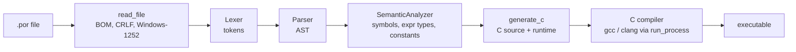

# Spike internals

Notes for people working on the compiler itself. The user-facing language is described in `language.md`; the C runtime in `runtime.md`; how to send a change in `CONTRIBUTING.md`.

## Pipeline



Every phase has the same shape: it takes its input, collects problems in a `Diagnostics` object, and exposes `had_error()` and `diagnostics()`. The driver (`src/driver/compile_pipeline.cpp`) runs the phases in order and stops after the first phase with errors. `spike check` stops after the analyzer, `--ast` after the parser, `spike tokens` after the lexer.

## Folder map

| Folder | What lives there |
| --- | --- |
| `include/spike/` | public headers of `spike_core` (one per module) |
| `src/io/` | reading the source file: UTF-8 check, BOM, line endings, Windows-1252 conversion (W010) |
| `src/lexer/` | tokens; `lexer_core` (main loop, comments) and `lexer_scan` (numbers, texts, names) |
| `src/parser/` | recursive descent, one file per construct, plus `parser_recovery` |
| `src/ast/` | the AST enums and `ast_printer` (`--ast`) |
| `src/semantic/` | symbol table, types, constants, control flow checks, warnings |
| `src/builtins/` | the single table of built-in functions, read by the analyzer and the generator |
| `src/codegen/` | the C generator, one file per kind of statement |
| `src/diagnostics/` | `Diagnostics`, the source view with the arrow, suggestions, UTF-8 helpers |
| `src/driver/` | the pipeline, the C compiler driver, output paths, `--time` |
| `src/process/` | `run_process`, `find_executable`, `get_env`, `TempDir` |
| `src/cli/`, `src/commands/` | argument parsing, help, colors, console setup, `fetch`, `dev`, `--explain` |
| `src/setup/` | `spike setup` and the pinned w64devkit download |
| `src/platform/`, `src/util/` | UTF-8 arguments on Windows, SHA-256 |
| `runtime/` | the C99 runtime, header-only, embedded in every generated program |
| `cmake/` | build helpers: runtime and error catalog embedding, size and doc checks |
| `tools/` | `spike_doctest`, which tests the examples in the docs |
| `tests/` | unit tests per module, programs, e2e cases, runtime tests in C |

## Modules

- **Lexer** (`Lexer(source, filename).tokenize()`). Turns text into tokens ending in `END_OF_FILE`. Keywords ignore case. It keeps scanning after an error, so every lexical error shows up in one run, but the compilation stops before the parser if there was any.
- **Parser** (`Parser(tokens, filename, source).parse()`). Builds a `Program`. It recovers from errors (see below), so it never stops at the first one.
- **Semantic analyzer** (`SemanticAnalyzer(program, filename, source).analyze()`). Resolves names, computes the type of every expression, evaluates constants, checks calls against signatures and emits the warnings. It does not change the AST.
- **Builtins** (`builtins.hpp`). `BuiltinSig{name, params, result, c_name, takes_line}`. The analyzer uses `find_builtin` to type a call (exact types first, then `inteiro` to `real`); the generator uses `c_name` and `takes_line` to emit it.
- **C generator** (`generate_c`). Only runs on a program that passed the analyzer. It never prints anything; it returns `CodegenResult{ok, c_source, error_code, ...}`.
- **Driver**. Finds the C compiler, writes the C into a `TempDir`, compiles it, moves the executable, runs it for `--run`, and prints the `ok:` or `falhou:` summary.

## AST and the type map

The AST (`include/spike/ast.hpp`) has no virtual classes. `Expr` and `Stmt` are small structs that hold a `std::variant` of node types (`BinaryExpr`, `CallExpr`, `SeStmt`, `ParaStmt`...) plus `line` and `col`. Children are `std::unique_ptr` (`ExprPtr`, `StmtPtr`, `StmtList`), built with `make_expr` and `make_stmt`. Code that walks the tree uses `std::visit` or `std::get_if`.

`Program` holds `consts`, `globals`, `procedures` (functions are procedures with a `return_type`) and `body`.

The analyzer's results live outside the tree:

- `expr_types()`: `unordered_map<const Expr*, TypeKind>`, one entry for every expression it visited (`Invalid` for those with errors).
- `symbols()`: the `SymbolTable`, keyed by the lowercase name.
- `constants()`: the value of each constant, computed at compile time.

Because the type map is keyed by node addresses, the `Program` must not move or change after the analysis. The generator reads the type of each expression from the map instead of computing it again, so both phases always agree.

## How the generator and the runtime fit

The runtime (`runtime/*.h`) is plain C99, header-only, every function `static inline`, every name prefixed `spike_` or `SPIKE_`. At build time `cmake/embed_runtime.cmake` concatenates the headers into a byte array (`build/generated/runtime_text.cpp`). The generator writes that text at the top of every C file, followed by the program:

1. A comment `/* Gerado pelo Spike <version> a partir de <file> */`.
2. The runtime.
3. `spike_source_lines`, the lines of the `.por`, used by runtime errors.
4. Globals `v_<name>` with their default value, prototypes, then procedures `p_<name>` and functions `f_<name>`.
5. `main`, which calls `spike_init()`, runs the body, and ends with `spike_flush()` and `spike_cleanup()`.

The generated code never uses a C operator whose behaviour can be undefined: `+ - *` on integers call `spike_add_int` and friends, `/` calls `spike_div_real` with the line, `div` and `mod` check for zero, an index goes through `spike_index`. Anything that can fail at run time receives the `.por` line and calls `spike_fail`, which prints the `erro de execução[R...]` message and exits with 101. That is why the executable needs nothing but the C library.

## Diagnostic format

```
erro[E700]: variável 'notaa' não foi declarada
 --> media.por:8:12
     |
   7 |   escreval("Média: ", (nota1 + nota2) / 2)
   8 |   escreval(notaa)
     |            ^
   9 | fimalgoritmo
     |
     = dica: você quis dizer 'nota1'? Declare 'notaa' na seção var.
```

`Diagnostics::error(code, message, line, col, hint)` stores the entry; `print_all()` draws it. The header is `erro[...]` or `aviso[...]`, the location is `file:line:col`, the source view shows one line of context on each side, and the hint is optional. Codes are grouped by phase (E0xx lexer, E1xx-E6xx parser, E7xx analyzer, E8xx newer parser constructs, E9xx generator and driver, Wxxx warnings, Rxxx runtime). Every code has an entry in `errors.md`, which is also compiled into `spike --explain`.

## Process execution

Spike has to start other programs: the C compiler, and with `--run`, the program it just built. All of that goes through one function, `run_process` in `include/spike/process.hpp`, and it never involves a shell. There is no `system()`, no `popen()`, no `sh -c` and no `cmd /c` anywhere in `src/`.

### Why no shell

A shell reads a command line as a small program. Quotes, `;`, `&`, `|`, `$(...)`, backticks and `%VAR%` all mean something. If Spike built a command line by gluing strings together, a file named `a; rm -rf ~.por` or `x & del *.por` would run commands the student never asked for. Escaping rules differ between `sh`, `cmd.exe` and PowerShell, so "escape it carefully" is not a fix.

Instead, `run_process` takes the arguments as a list (`ProcessOptions::args`, with the program in `args[0]`) and hands that list to the operating system directly. Each argument reaches the child exactly as written. The test `test_process_arguments_arrive_intact` proves it with a helper program, `spike_echo_args`, that prints every argument it receives: spaces, quotes, `;`, `$(whoami)`, `%PATH%`, `&&`, `|`, `>`, trailing backslashes and accented letters all come back unchanged.

### Finding the program

`find_executable` resolves `args[0]` before anything runs. A name with a directory part is used as is; a bare name is looked up in `PATH` by Spike itself, directory by directory. On Windows `.exe` is tried first. Empty `PATH` entries are skipped, so the current directory is never searched by accident. The child is then started with the full path, which also stops Windows from looking in the current directory first.

### POSIX

`posix_spawn` with file actions: the optional stdin file is opened by Spike and `dup2`'d onto the child's stdin, and capture pipes are `dup2`'d onto stdout and stderr. Spike reads both pipes with `poll`, so a child that fills one pipe while Spike waits on the other cannot deadlock. `waitpid` gives the exit code; a child killed by a signal reports `128 + signal`, like shells do.

### Windows

`CreateProcessW` with the resolved path as the application name and a command line built with the quoting rules that `CommandLineToArgvW` and the C runtime use to split it again: arguments with spaces, tabs or quotes are wrapped in quotes, quotes are escaped with a backslash, and backslashes are doubled only when they come before a quote. All strings are UTF-8 inside Spike and converted to UTF-16 at the API boundary, so paths like `C:\Users\João` work. Capture uses inheritable pipes whose read ends are not inherited; stderr is drained on a second thread while stdout is read on the calling thread.

### Errors

If the program cannot be found or started, `launched` is false and `launch_error` says why, in Portuguese. A started program that fails just reports its `exit_code`.

## C compiler driver

`include/spike/cc_driver.hpp`.

- `find_c_compiler(bundled_dir)` looks in this order: the `SPIKE_CC` environment variable (if set and invalid, the search stops and the result is E902, because the user asked for that compiler); the compiler recorded by `spike setup` in `%LOCALAPPDATA%\Spike\toolchain.txt`; `bundled_dir/bin/{gcc,clang,cc}`; then `cc`, `gcc`, `clang` in `PATH` (`gcc`, `clang` on Windows). `kind` comes from the file name.
- `compile_c` runs `[compiler, -O2 or -O0, -std=c99, -o, output, c_file, -lm]` with both output streams captured. It never adds `-Werror`: warnings in generated code are Spike's problem, not the student's.
- Errors come back as data (`DriverError{code, message, hint, details}`); the CLI prints them. E902: no compiler. E903: the compiler rejected the generated C, which is always a Spike bug; `details` holds the first 20 lines of compiler output. E904: a file could not be written.

## Parser error recovery

The parser keeps going after an error, so a student sees every real mistake in one run, but it must not invent errors that only follow from the first one. The code lives in `src/parser/parser_recovery.cpp`.

- **Insertion.** When an expected word is missing but the rest is fine (`entao`, `faca`, `de`, `ate` in a `para`, `inicio`), the parser reports it and carries on as if the word were there. The body of the block is parsed normally, so errors inside it still show up.
- **Unclosed blocks.** A statement list stops at its own closing word or at the closing word of any block around it (`block_stops_`). A `se` without `fimse` inside an `enquanto` stops at `fimenquanto`, reports one E401 pointing at the `se`, and leaves `fimenquanto` for the loop. `fimalgoritmo` is only checked once, at the end of the program.
- **Panic mode.** After a statement with an error, `synchronize` drops tokens until a closing word, the end of the file, or the start of a statement on a later line than the error (a keyword like `se` or `escreva`, or a name at the start of its line). It never stops on a token from the same line, which is what turns one broken line into one error.
- **Missing expressions** become an `ErrorExpr` node and the token after it is left alone; a value missing at the end of a line (`x <-`) never swallows the next line. No operator is read after an `ErrorExpr`, so `(+)` gives one E201.
- **No duplicates.** Every parser error goes through `report()`, which drops a second error at a position that already has one. `Diagnostics` keeps at most 20 errors and prints `(mais N erros omitidos)` for the rest.
- **Always terminates.** Each pass of the statement loop consumes at least one token. Nesting (blocks, parentheses, `nao`, unary minus, `^`) is capped at 256 levels by `NestingGuard`; past that the parser reports E202 and jumps to the end of the file instead of overflowing the stack.
- **Fatal cases.** A missing `algoritmo` still stops the parse with a single E100. Lexical errors (E001 to E004) stop compilation before the parser runs, but the lexer itself keeps scanning after each one, so all of them are shown together.

## Diagnostic positions

- **Columns are characters.** `Token::col` and every AST `col` count UTF-8 code points from 1, not bytes: the lexer only advances the column on bytes that are not continuation bytes (`10xxxxxx`). A tab counts as one column. `Token::length` is the token's size in the source, in the same unit, quotes and escapes included (`"a\"b"` is 6), so `error_after(token)` (`src/parser/parser_recovery.cpp`) gives the column just past its last character.
- **Missing words.** Every "esperado" error goes through `expected_pos()`: if the offending token is on a later line than the last good token, the error points just after that last token; on the same line it points at the offending token. Errors about a token itself (E104, E300) and about a block left open keep their own positions.
- **Drawing the arrow** (`src/diagnostics/source_view.cpp`). The printed line is rebuilt cell by cell: every character takes one cell, a tab becomes 4 spaces, and an invalid byte is shown as `?`. The arrow's indent is computed by walking the original line with the same rule, so it lands under the right character with tabs and accents. Wide characters (emoji, CJK) still take one cell in this count and can push the arrow left of where it looks on screen; that is accepted.
- **Long lines.** A line wider than 100 cells is shown as an 80-cell window around the arrow, with `...` on each side that was cut, and the arrow's indent shifts to match. The context lines above and below use the same window.
- **Invalid UTF-8.** Before scanning, the lexer checks the whole file (`src/diagnostics/utf8.cpp`). The first invalid sequence (bad lead byte, missing continuation, overlong form, surrogate, past U+10FFFF) gives E005 at its line and column, and nothing else is reported. Reading Windows-1252 files is prompt 060.
- **Accents in names.** Names are ASCII only (decision 7). A Latin-1 Supplement or Latin Extended-A letter inside a name is read as part of the word, so `média` is one token with one E001 at the `é`, and the hint spells the name with `strip_accents` (`media`). Any other non-ASCII character outside strings and comments is one E001 with the whole character in the message.

## Diagnostics output

- **Streams.** Errors, warnings, the `ok:` lines, `--verbose` and `--time` go to stderr. stdout carries only what the user asked to see: `--help`, `--version`, `--ast`, `--explain`, the `tokens` listing and, with `--run`, the program itself.
- **Summary.** `Reporter` (`src/driver/pipeline_report.cpp`) adds up the errors and warnings of every phase (`record`, `record_error`) and prints `falhou: ...` plus the `spike --explain` suggestion at the end. The suggestion uses the code of the error with the earliest position (`Diagnostics::first_error_code`) and only appears when that code is in the catalog.
- **Colors.** All color goes through `paint` in `src/cli/colors.cpp`, which asks `enabled(stream)` every time: `--color` wins, then `NO_COLOR`, then `FORCE_COLOR`, then whether that stream is a terminal (`isatty` / `_isatty`). The helpers (`red`, `bold`...) take the stream the text is written to, stderr by default. On Windows `init_colors` turns on ANSI sequences for both consoles.
- **Error catalog.** `cmake/embed_errors.cmake` reads `docs/errors.md` at build time and writes `build/generated/error_catalog.cpp`, a table sorted by code behind `all_errors()` and `find_error()` (`include/spike/error_catalog.hpp`). A malformed entry stops the build with a message saying what is missing. `cmake/check_error_docs.cmake` (CTest `error_docs_consistency`) compares the codes quoted in `src/` and `runtime/` (plus the `SPIKE_R_*` numbers of the C runtime) with the titles in the doc.

### Names the C compiler sees on Windows

MinGW's `gcc.exe` reads its command line in the ANSI code page, so a path with a character outside it (a Greek letter, or a user folder with letters the code page lacks) reaches it broken, even though Spike passes UTF-8 converted to UTF-16 through `CreateProcessW`. On Windows the pipeline therefore writes the C file as `programa.c` in the temporary folder, runs the compiler with that folder as its working directory (`ProcessOptions::working_dir`) and the output `programa.exe`, and then moves the executable to the requested path with `std::filesystem`, which uses the wide API. On Linux and macOS paths are bytes, UTF-8 passes through unchanged, and the compiler gets the real names.

Spike reads its own arguments with `GetCommandLineW` and `CommandLineToArgvW` (`src/platform/arguments.cpp`), because the narrow `argv` of `main` is also in the ANSI code page.

## spike setup

`spike setup` downloads one pinned file: the w64devkit release in `src/setup/toolchain_pins.hpp` (name, version, URL, size and SHA-256). Only Windows downloads, with WinHTTP over HTTPS, certificate checks on and redirects allowed only from HTTPS to HTTPS. The file lands as `.part` in `%LOCALAPPDATA%\Spike\toolchain\<version>\`, and only after its size and SHA-256 match the pins it is renamed and run as a 7-Zip self-extractor with `-y -o<folder>`. Then `gcc --version` must run, and the path of `gcc.exe` goes into `%LOCALAPPDATA%\Spike\toolchain.txt`, which `find_c_compiler` reads right after `SPIKE_CC`. Download, extraction and the `gcc` probe are injected (`InstallTools`), so the tests run the whole flow with fakes and never touch the network. Linux and macOS only print the install command.

To move to a newer w64devkit:

1. Open https://github.com/skeeto/w64devkit/releases/latest and pick the `w64devkit-x64-<version>.7z.exe` asset. The repository must be `skeeto/w64devkit`.
2. Download it once and compute the hash yourself (`sha256sum`, or `Get-FileHash` on Windows). It must equal the `sha256:` digest GitHub shows for the asset, and the size must equal the asset size. If either differs, stop.
3. Update all five values in `toolchain_pins.hpp` in one commit, and check that the archive still unpacks to `w64devkit/bin/gcc.exe` (the release Dockerfile packs `$PREFIX=/w64devkit`).
4. Run the manual CI job (Actions, "CI", Run workflow, `windows_setup` checked), which runs the real `spike setup` on Windows.

## Releases

`.github/workflows/release.yml` runs on a pushed tag `vX.Y.Z` and by hand (Actions, "release", Run workflow). The manual run defaults to `dry_run`: it builds, tests and packages everything and uploads the packages as artifacts, but creates no release. A real release only comes from a tag.

- `verify` reads `project(Spike VERSION ...)` from `CMakeLists.txt`, checks that the tag without the `v` matches it, and that `CHANGELOG.md` has a `## [X.Y.Z]` section (`scripts/extract_changelog.cmake`).
- `build` runs on `ubuntu-22.04` (glibc 2.35, so the binary also runs on Debian 12), `macos-latest` (arm64), `macos-15-intel` (x86_64; GitHub's last Intel macOS image, expected until about 2027) and `windows-latest`. Linux links `libstdc++` and `libgcc` statically; Windows uses the static MSVC runtime (`CMAKE_MSVC_RUNTIME_LIBRARY=MultiThreaded`), so `spike.exe` needs only system DLLs. Each job runs `ctest`, builds `spike-X.Y.Z-<system>-<arch>.(zip|tar.gz)` and then unpacks it elsewhere and runs `spike --version` and `examples/hello.por`.
- `publish` (the only job with `contents: write`) writes `SHA256SUMS.txt`, takes the notes from the changelog section plus a note that Windows needs `spike setup`, and runs `gh release create --verify-tag`. Versions `0.x` are marked as pre-releases.

A fully static Linux binary (`-static`) was left out: glibc warns against it, Spike gains nothing because it calls the system C compiler, which brings glibc anyway, and building on an older glibc already covers the common distributions.

To release: bump `project(... VERSION ...)`, rename `## [Unreleased]` in `CHANGELOG.md` to `## [X.Y.Z] - date`, commit, run the workflow by hand with `dry_run`, and only then push the tag.

## Code generation notes

- `generate_c` takes a `CodegenOptions{source, emit_line_directives, c_file_name}`. `source` is the `.por` text; its lines (with `\r\n` already turned into `\n`) become `spike_source_lines` at the top of the C file, so a runtime error can show the line. That array is the only copy of the source in the C file.
- With `emit_line_directives`, every command gets `#line <n> "<arquivo>.por"` before it, and after the body of `main` and of each subprogram, where the code is the runtime's again, a `#line <next line> "<c_file_name>"` points back to the C file. A C compiler error then names the `.por` line, and E903 shows it. `#line` only changes what the compiler reports; the program is the same (`codegen_line_test` compiles three examples both ways and compares the output).
- The pipeline always compiles the version with `#line`. The copy saved by `--c` is generated again without it, because it is meant for the student to read.
- Every generated procedure and function takes the line of the call as a first parameter, `int spike_line`, and passes it to `spike_enter` with its name. That is what the call stack in a runtime error shows. A hidden parameter is used instead of a global so that a call inside the arguments of another call (`f(g(x))`) cannot leave the wrong line behind.

- `interrompa` becomes a plain C `break;`. It always leaves the innermost C loop, which is the innermost Portugol loop: a `para` is wrapped in a `{ }` block for its temporaries, but the block is not a loop, so `break` still leaves the `while` inside it.
- Because of that, `escolha` must never be generated as a C `switch`. A `break` inside a `switch` leaves the `switch`, so an `interrompa` written inside an `escolha` that sits in a loop would stop the `escolha` instead of the loop. `escolha` has to become an `if` / `else if` chain.

## Text memory

Texts built while a program runs (joins with `+`, `copia`, `maiusculo`, `paraTexto`, lines read by `leia`) are never freed one by one. Each lives in its own block in a list owned by the runtime, and `spike_cleanup` frees the whole list when the program ends. This keeps the generated C simple, with no ownership to track, and a normal student program uses little memory.

The cost shows up when a text grows inside a loop: `t <- t + "x"` repeated n times copies the whole text each time and keeps every old copy, so it takes time and memory proportional to n². Ten thousand rounds use about 50 MB; a hundred thousand would need several GB. Nothing is optimized for this yet. If it becomes a problem, the likely fix is to free the old text when the generated code can prove nothing else points to it, or a builder for texts that grow.

## Temporary files

`TempDir` (`include/spike/temp_dir.hpp`) creates a uniquely named folder under the system temp directory (`spike-<pid>-<random>`) and deletes it with everything inside when it goes out of scope, even on an error path. The generated `.c` (with `#line`) lives there; with `--c` a version without `#line` is written next to the executable.

## Adding a feature to the language

Every language feature follows the checklist in `CLAUDE.md`, in this order. The commit that added `div`, `mod` and `^` (`3956b3c`, "feat: add div, mod and power operators") is a good model, because it touches every layer:

1. **Spec.** `docs/language.md`: the precedence table got `div`, `mod` and `^`, and the rules for each (`div` cuts toward zero, `^` groups right to left, `-2 ^ 2` is `-4`).
2. **Lexer.** New tokens `DIV`, `MOD` and `CARET` in `token.hpp`, the two keywords in the lexer's keyword table and `^` in its symbol scanner. A test makes sure a longer word that starts the same way (`dividir`, `modo`) is still a name.
3. **AST.** `BinaryOp::IntDiv`, `Mod` and `Pow` in `ast_enums.hpp`, with `to_string` for the printer.
4. **Parser.** `parser_expr.cpp` got a new precedence level for `^` (right-associative) and put `div` and `mod` next to `*` and `/`. `tests/parser/expr_power_test.cpp` checks the tree for each tricky case.
5. **Analyzer.** `semantic_types.cpp`: `div` and `mod` take two `inteiro` (a `real` is E710), `^` always gives `real`. A file in `tests/programs/semantic_invalid/` (`e710_mod_with_real.por`) covers the error.
6. **Generator.** `codegen_expr.cpp` emits `spike_div_int`, `spike_mod_int` and `spike_pow` with the line, never the bare C operator.
7. **Runtime.** `spike_runtime_core.h` got those functions (zero divisor is R001, an invalid power is R005), with tests in `tests/runtime/runtime_test.c` and a line in `docs/runtime.md`.
8. **Examples and e2e.** `examples/operators.por`, e2e cases `operators`, `integer_div_by_zero` and `power_invalid` with the output computed by hand, and an `e2e_errors` case for E710.
9. **Error docs.** `docs/errors.md` updated for the codes involved.
10. **Changelog.** `CHANGELOG.md`, with `div` and `mod` under "Changed" because they became reserved words.
11. **CLAUDE.md**, when the structure, the rules or the codes change.

A new statement also needs its synchronization points in `parser_recovery.cpp`: its closing word goes into `is_closing_keyword` and its opening word into `is_statement_keyword`, so a block left open gives one error, at the word that opened it.

## Running the tests

```
cmake -S . -B build
cmake --build build -j
ctest --test-dir build --output-on-failure
```

On Windows with MSYS2, add `-G Ninja` to the first command and put `C:\msys64\ucrt64\bin` first in `PATH`.

| What | How |
| --- | --- |
| Everything | `ctest --test-dir build --output-on-failure` |
| Unit tests only | `build/spike_tests` (prints `all tests passed`); `build/spike_tests lexer parser` runs only the groups whose name contains a filter |
| End-to-end programs | `ctest --test-dir build -L e2e` (see `tests/e2e/README.md`) |
| Examples in the docs | `ctest --test-dir build -R docs_examples` |
| Sanitizers | configure with `-DSPIKE_SANITIZE=ON` (GCC or Clang) |
| File sizes and error docs | `check_file_sizes` and `error_docs_consistency`, both in CTest |

Tests that compile generated C need a C compiler; `SPIKE_TEST_CC` chooses it. Without one, those tests are skipped (e2e exits with 77) and `docs_examples` only runs `spike check` on the `portugol-run` blocks.

**Fuzzers.** Not written yet; they arrive with prompt 069. The plan is a libFuzzer target per phase (lexer, parser, analyzer, generator) under `tests/fuzz/`, built only with Clang and `-DSPIKE_FUZZ=ON`, with a seed corpus from `examples/` and `tests/programs/`. This section will say how to run them.

## Decisions and why

| Decision | Why |
| --- | --- |
| Compile to C instead of interpreting | A standalone executable is one of Spike's three promises, and the student can read the C with `--c`. |
| AST with `std::variant`, no virtual classes | Every pass is a `std::visit`, the compiler checks that each node type is handled, and nodes stay plain data. |
| Types in a side map, not in the AST | The parser output never changes after parsing; the analyzer and the generator share one answer for each expression. |
| Runtime as embedded header-only C | The generated C file is self-contained: one file, one compiler call, nothing to link but `-lm`. |
| No `system()` or `popen()` | File names chosen by students must never be read by a shell (see "Why no shell"). |
| `escolha` becomes `if` / `else if` | A C `switch` would make `interrompa` leave the `escolha` instead of the loop. |
| `inteiro` is 64 bits; `/` always gives `real` | Fewer surprises for beginners: `7 / 2` is `3.5`, as in math class (decision 5). |
| Names are ASCII only | Portable C names and no encoding trouble in identifiers; accents still work in texts and comments (decision 7). |
| Texts are never freed one by one | Simple generated C with no ownership; the cost is only visible in long loops that grow a text (see "Text memory"). |
| `spike setup` downloads only on request, with a pinned SHA-256 | Nothing is downloaded behind the student's back, and a tampered file is never run. |
| One commit per prompt, files under 300 lines | Small, reviewable changes; a file that grows past the limit is split by topic. |

Product decisions (audience, dialect, platforms) are in `decisions.md`.
